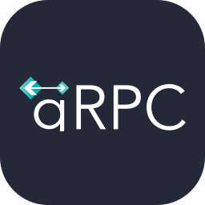
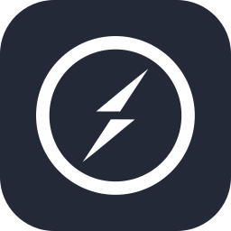
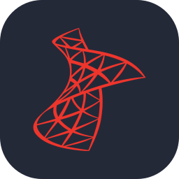

# Olá, eu sou o Gustavo 👋

**Engenheiro de Software · Arquiteto de Soluções**

Construo backends e produtos SaaS com foco em arquitetura limpa, segurança desde o design e viabilidade de negócio. Trabalho com Java/Spring, C#/.NET, TypeScript e Python, do modelo de domínio até a operação em produção.

📍 Pedro Leopoldo, MG · 🟢 Aberto a oportunidades

---

## Experiência

### 💼 Analista Desenvolvedor de Software · Agência do Japa
dez. 2025 – atual

Desenvolvimento fullstack do [Zyntra ERP](https://zyntraerp.com.br), um ERP SaaS industrial multi-tenant em produção que cobre vendas, compras, PCP, financeiro, estoque, RH e emissão fiscal (NF-e via SEFAZ e CNAB 240).

- Reforcei o controle de acesso (RBAC) dos módulos com security by design, reduzindo a superfície de ataque.
- Diagnostico e corrijo módulos em produção e entrego funcionalidades de ponta a ponta, do frontend às APIs e regras de negócio.
- Criei o Concord, chat interno do ERP inspirado no Discord.
- Desenvolvi os agentes de IA Cleo, Bob e Evelyn. O Bob abre e acompanha chamados de TI direto na conversa do Concord.
- Desenvolvi jogos digitais, como o Ultrafoot 26.

### 🛠️ Desenvolvedor de Sustentação · Rumo Soluções
jul. 2026 – atual

Sustentação e evolução de sistemas em C#/.NET e Angular/Ionic.

- Estruturo APIs e regras de negócio em C#/.NET.
- Construo e corrijo interfaces web e mobile em Angular e Ionic, com foco em usabilidade.
- Desenvolvo aplicações financeiras e robôs de captura web que alimentam sistemas de pricing de locadoras e concessionárias.

### 🏗️ Fundador e Arquiteto de Software · ZenithCode
out. 2025 – atual

Projetos autorais de arquitetura e segurança, organizados sob o Z2A, um meta-framework de governança e ciclo de vida de código que é a base da minha pesquisa de mestrado. Inclui o AegisProtocol, o OmniShift, o Vertex, o Panoptes e o Nidhogg.

### Antes do desenvolvimento

Suporte técnico em TI na R2 Internet, supervisão de estoque no Grupo CMD e manutenção de eletrônicos na Turrek Informática. Fui promovido nos três empregos. Na R2, a promoção a técnico foi a mais rápida que a equipe já teve. No Grupo CMD, liderei a migração do controle de estoque de planilhas para um sistema eletrônico.

## Sobre mim

- 🎓 Formado em Análise e Desenvolvimento de Sistemas, com MBAs em Segurança da Informação e em Gestão Financeira e Controladoria. Cursando Engenharia de Software.
- 🥋 Instrutor de karatê e presidente da Associação Ventura e Vianna, que atua com ajuda social. A associação teve duas leis aprovadas em Pedro Leopoldo, entre elas o reconhecimento do karatê como patrimônio cultural.

## Stack

**Backend**

          

**Frontend e mobile**

      

**Dados e mensageria**

     

**Cloud e DevOps**

       

**Arquitetura:** Clean Architecture · Hexagonal · DDD · CQRS · Monólito modular e microsserviços

**Segurança:** Zero Trust · OAuth2/OIDC · JWT · RBAC/ABAC · OWASP · LGPD

**IA:** Agentes · LLMs locais com Ollama · LangChain · RAG

## Projetos em destaque

| Projeto | Status | O que é | Stack |
|---|---|---|---|
| **[Zyntra ERP](https://github.com/jovemegidio/Zyntra)** | 🟢 Em produção | ERP SaaS industrial multi-tenant, com clientes reais desde janeiro de 2026 e assistente de IA que abre chamados de suporte | Node.js · MySQL · Socket.IO · Python |
| **[AKPL](https://karatepl.zyntraerp.com.br)** | 🟢 No ar | Gestão acadêmica com 6 perfis de acesso. Roda a gestão da minha própria academia | Next.js 15 · Prisma · PostgreSQL |
| **[MobiliTudo](https://github.com/Gtvnv/MobiliTudo)** | 🟢 No ar | Mapa colaborativo de acessibilidade urbana, com rotas que desviam de barreiras | Java 21 · Spring Boot · PostGIS |
| **[Ultrafoot 26](https://remake-ultrafoot.vercel.app)** | 🟢 No ar | Remake de um clássico jogo de futebol, para desktop e mobile ([código](https://github.com/jovemegidio/Ultrafoot26)) | Next.js · Tauri · C# |
| **[AegisProtocol](https://github.com/Gtvnv/AegisProtocol-Core)** | 🟡 Em desenvolvimento | Identity Provider Zero Trust com JWT (RS256) e revogação distribuída | Java 21 · Spring Security · Redis |
| **[OmniShift](https://github.com/Gtvnv/OmniShift)** | 🟡 Em desenvolvimento | Motor de transformação de dados entre formatos e protocolos | Java 21 · Spring Boot · gRPC |
| **[Vertex](https://gtvnv.github.io/projects/vertexflow)** | 🟡 Em desenvolvimento | Plataforma interna que gera um microsserviço Go pronto a partir de uma especificação YAML | Go · Pulumi |

Os demais projetos, incluindo a pesquisa do ZenithCode OS, estão no **[portfólio](https://gtvnv.github.io)**.

## Linguagens nos repositórios públicos

